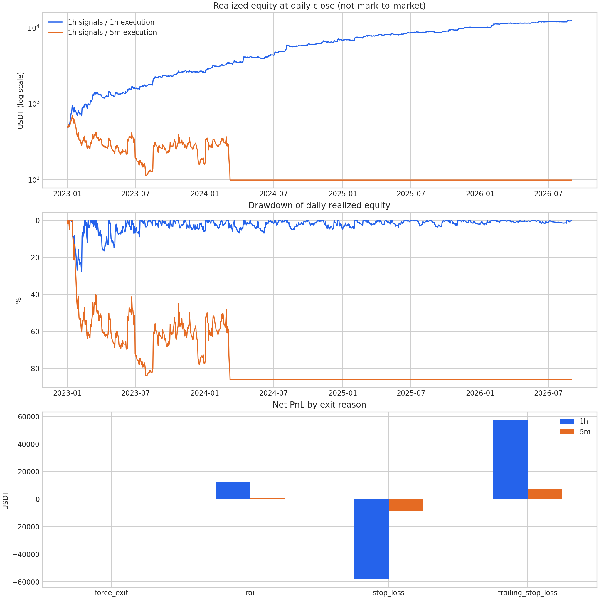
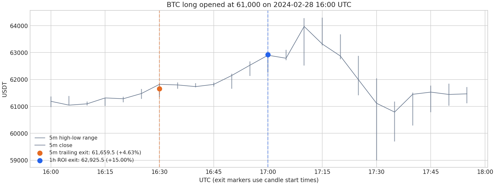

# MyStrategy 1h 与 5m 细化回测收益差异分析

本文全部资金、权益与逐笔案例均来自历史回测模拟，不包含真实账户余额、真实成交记录或实盘业绩。完整策略源码已公开。

本次比较保持策略的主周期为 **1h**，只改变成交与退出过程的模拟精度。5m 细化回测没有把 SMA240、EMA10 改为 5m 指标，也没有重新优化策略参数。为排除本地两种周期行情的少量不一致，主比较的两组都使用同一套 5m 行情及其聚合得到的 1h 行情。

**结论：普通 1h 的高收益没有在 5m 细化下保持。** 同源数据下，1h 普通回测收益率为 **+2,393.40%**，5m 细化为 **-80.19%**，净利润相差 **12,367.95 USDT**。

差异始于退出成交模拟：小时内移动止损与 ROI 的触发顺序、本版本开仓 K 线的特殊止损定价，都会改变实际兑现的利润；随后，更早或更晚释放的持仓名额改变交易序列，资金路径进一步分化。细化组最终余额低于固定开仓要求，2024-03-08 后没有再成交。因此，这不是对同一批交易统一调低收益的结果。

## 总体结果

| 指标 | 1h 普通回测 | 1h 信号与 5m 细化 |
| --- | ---: | ---: |
| 初始资金 USDT | 500.00 | 500.00 |
| 最终余额 USDT | 12,467.01 | 99.06 |
| 净利润 USDT | 11,967.01 | -400.94 |
| 总收益率 | +2,393.40% | -80.19% |
| 交易笔数 | 21,074 | 3,017 |
| 胜率 | 54.53% | 52.87% |
| 平均单笔收益率 | +0.5745% | -0.1372% |
| Profit Factor | 1.205 | 0.955 |
| 最大相对回撤 | 33.96% | 87.18% |
| 最大绝对回撤 USDT | 437.08 | 673.59 |
| 平均持仓时间 | 7 小时 16 分钟 | 8 小时 01 分钟 |
| 最后一笔平仓时间 UTC | 2026-09-01 00:00 | 2024-03-08 15:30 |

两组引擎回测范围都运行至 2026-09-01。细化组最后余额为 99.06 USDT，低于配置的 100 USDT 单笔目标保证金，且未补充资金；后续零成交不能解释为没有趋势信号，也不能把 3,017 对 21,074 笔直接解释为细化会降低交易频率。

最大相对回撤采用引擎的 `max_relative_drawdown`。1h 命令行摘要中的 7.20% 对应最大美元回撤区间的比例，该区间与全期最大比例回撤并非同一段；全期最大相对回撤为 33.96%。这些指标基于已平仓交易，不是包含浮动盈亏的实时账户回撤。



图中权益为每日已平仓盈亏累计，首图使用对数纵轴；回撤图由每日已实现权益计算。它们不包含未平仓浮动盈亏，回撤图也不等同于表中的引擎逐笔回撤指标。

## 收益差异的量化证据

### 盈利单收益下降使单笔期望转负

1h 的盈利单平均收益率为 **6.22%**，细化组降至 **5.36%**；亏损单平均收益率分别为 **-6.19%** 和 **-6.31%**。配合胜率从 54.53% 降至 52.87%，按“胜率 × 平均盈利 + 败率 × 平均亏损”得到的引擎平均单笔收益率由 +0.5745% 变为 -0.1372%。这些收益率均已包含费用影响。

| 退出原因 | 1h 笔数 | 1h 平均收益率 | 1h 净利润 USDT | 5m 笔数 | 5m 平均收益率 | 5m 净利润 USDT |
| --- | ---: | ---: | ---: | ---: | ---: | ---: |
| `trailing_stop_loss` | 10,846 | 5.38% | 57,535.21 | 1,527 | 4.92% | 7,446.84 |
| `roi` | 848 | 15.00% | 12,560.80 | 69 | 15.00% | 1,027.45 |
| `stop_loss` | 9,375 | -6.29% | -58,122.99 | 1,421 | -6.31% | -8,875.23 |
| `force_exit` | 5 | -1.21% | -6.01 | 0 | — | 0.00 |

移动止损单平均收益率从 5.38% 降至 4.92%；ROI 单占比从 4.02% 降至 2.29%。由于交易集合和活跃期不同，不能把这张表的总额差直接当成某一种退出规则的独立因果贡献；下文用共同入场交易检查实际发生的变化。

### 名额释放与资金约束改变了大部分交易集合

按“交易对、方向、入场时间”精确匹配，共有 **288 笔共同入场**，这些交易的入场价格和保证金均一致。仅普通组出现 20,786 笔，仅细化组出现 2,729 笔。细化组有 **2,578 笔，即 85.45% 的入场不在整点**，说明释放名额后使用同一个 1h 信号入场，确实改变了交易序列；这不代表策略重新计算了 5m 指标。

对共同入场的 288 笔，细化组净利润比普通组少 **92.58 USDT**。其中 21 笔改变退出原因：16 笔由 ROI 变为移动止损，合计少赚 118.48 USDT；5 笔由固定止损变为移动止损，合计改善 57.36 USDT。细化并非使每一笔交易都变差。

全期利润差可以精确对账为：

```text
5m 净利润 − 1h 净利润
= 共同入场的盈亏差 + 仅 5m 出现的交易盈亏 − 仅 1h 出现的交易盈亏
= −92.58326663 − 489.33948862 − 11786.02698506
= −12367.94974031 USDT
```

这是一种会计分解。未配对部分包含了名额竞争、持仓延续、资金约束以及停止成交后的市场区间，不能把它全部归因为某一个机制。它说明：把全期约 1.24 万 USDT 的差额都说成“同一批交易的移动止损少赚了”，与逐笔数据不符。

### 手续费侵蚀了细化组较薄的价格利润

| 盈亏组成 USDT | 1h 普通回测 | 5m 细化 |
| --- | ---: | ---: |
| 仅按开平仓价计算的方向盈亏 | 18,216.71 | 590.19 |
| 双边手续费 | −6,109.19 | −964.21 |
| 资金费用净收入 | -140.51 | -26.91 |
| 最终净利润 | 11,967.01 | -400.94 |

手续费按成交数量、成交价格和费率重算，并与每笔净盈亏核对。两组费率相同；细化组全期总手续费更少，因此不能用“手续费总额增加”解释两组差距。但细化组只有 590.19 USDT 的价格利润，不足以覆盖 964.21 USDT 的手续费和 26.91 USDT 的资金费用，扣费后转为净亏损。

## BTC 同一笔入场的退出差异

2024-02-28 16:00 UTC，两组均以 **61,000 USDT** 做多 BTC，杠杆 5 倍，数量 0.008 BTC，实际保证金 97.60 USDT。

| 项目 | 1h 普通回测 | 5m 细化 |
| --- | ---: | ---: |
| 退出所属 K 线起始时间 UTC | 17:00 | 16:30 |
| 退出原因 | ROI | 移动止损 |
| 退出价格 | 62,925.5 | 61,659.5 |
| 引擎净收益率 | 15.00% | 4.63% |
| 净利润 USDT | 14.65 | 4.52 |

16:30 的 5m K 线高点为 61,845、低点为 61,347。引擎按高点调整移动止损，计算出的止损价约为 `61845 × (1 − 0.015 / 5) = 61659.465`，按精度处理为 61,659.5，位于该 K 线范围内，能够模拟成交。此后市场才继续上行，17:00 所属区间的高点达到 62,952.8，足以触及普通组的 ROI 价格。细化组已经离场，不能再把后续上冲计入这笔交易。

**这个例子还涉及本版本的开仓 K 线特殊处理。** 在 1h 开仓小时内，原生函数复算的移动止损候选退出价为：

```text
61000 × (1 + 0.05 − 0.015 / 5) = 63867
```

它超过了该小时高点 62,672.3，不满足原生 `low ≤ price ≤ high` 的限价成交检查；而细化组在第 30 分钟已不走零分钟持仓的特殊分支，候选止损价 61,659.5 可以成交。普通组最终在下一小时按 ROI 退出。原生函数复算结果见 [case_engine_check.json](case_engine_check.json)，可运行 [check_case_engine.py](check_case_engine.py) 核验。这里既有盘中路径差异，也有特定版本的止损定价与成交检查差异，不能简单归为“5m 噪声更大”。



图中的退出标记位于导出结果所记录的 K 线起始时间，不是逐笔成交时刻。竖线为各 5m K 线高低范围；5m 内部的先高后低仍是引擎假设。本仓库保留该历史模拟的图示和原生定价函数核验，不分发原始行情文件。

普通 1h 组共有 512 笔零分钟移动止损交易，合计盈利 4,454.46 USDT，约为全期净利润的 37.2%。这表明开仓 K 线内的处理值得重点核查；这个金额本身不是偏差估计。本次没有逐一替换引擎规则做全期消融，不能把全部收益差归为上述特殊分支。

## 分年度结果与资金路径

| 平仓年份 | 1h 笔数 | 1h 净利润 USDT | 5m 笔数 | 5m 净利润 USDT |
| --- | ---: | ---: | ---: | ---: |
| 2023 年 | 4,370 | 2,104.00 | 2,388 | -339.78 |
| 2024 年 | 6,953 | 4,233.89 | 629 | -61.15 |
| 2025 年 | 6,746 | 3,239.58 | 0 | 0.00 |
| 2026 年前八个月 | 3,005 | 2,389.54 | 0 | 0.00 |

2023 年两组都仍有成交时，1h 已盈利 2,104.00 USDT，细化组则亏损 339.78 USDT，差异在停止交易前已经形成。2025 年和 2026 年细化组没有成交，反映了此前损失与固定开仓资金门槛的后续影响；其零盈亏不是这些年份的市场适应性表现。


## 回测范围与共同配置

回测使用 [MyStrategy](../../user_data/strategies/my_strategy.py)，引擎版本为 Freqtrade 2026.8，CCXT 版本为 4.5.76。时间范围为 **2023-01-01 00:00 至 2026-09-01 00:00，均为 UTC**；预热数据从 2022-12-22 开始，包含所需的 240 根 1h K 线。结束时仍持有的仓位计入 `force_exit`。

| 项目 | 两组共同设置 |
| --- | --- |
| 交易场所 | Binance USDT 永续合约，逐仓 |
| 初始资金 | 500 USDT |
| 单笔保证金 | 固定 100 USDT，受余额、精度及交易所限额约束 |
| 最大同时持仓 | 5 |
| 策略信号与指标周期 | 1h，SMA240 与 EMA10 |
| 多空方向 | 均允许 |
| 杠杆目标 | BTC 5 倍，ETH 4 倍，SOL、XRP、BNB 3 倍，其余 2 倍 |
| 手续费 | 每侧成交名义金额的 0.05%，开平仓均计费 |
| 固定止损 | `stoploss = -0.06` |
| 最小 ROI | `minimal_roi = {"0": 0.15}` |
| 移动止损 | 盈利达到 5% 后启用，跟踪距离为 1.5% |
| 结果缓存 | `--cache none`，重新计算 |

交易对按配置中的固定顺序使用：BTC、ETH、SOL、XRP、BNB、DOGE、ADA、LINK、AVAX、LTC、BCH、DOT、NEAR、UNI，均为 `币种/USDT:USDT`。原始配置中的凭据、服务设置不进入报告；可复现的共同配置见 [无凭证研究配置](../../configs/research.example.json)。

单笔保证金固定为 100 USDT，因此不能把累计收益率解释为按账户权益固定比例加仓的复利表现。

## 为什么相同的 1h 信号仍会得到不同结果

### 退出取决于小时内部的价格路径

策略的入场条件是收盘价同时位于 SMA240、EMA10 上方时做多，同时位于两者下方时做空。条件持续满足时会持续产生入场信号，并非只在均线交叉时触发。`populate_exit_trend()` 始终将多空退出信号设为 0，实际平仓依靠固定止损、移动止损、ROI 和回测末尾强制退出。

1h OHLC 只能说明一小时的开高低收，无法还原先触及止盈还是先回撤触及止损。5m 细化把这一小时拆成 12 个有时间顺序的区间，逐段处理持仓；在某个 5m 区间已经退出的仓位，不能再获得这一小时后续走势带来的收益。Freqtrade 在同一根模拟 K 线内仍有既定的退出优先级和移动止损处理假设，5m 只是缩小这些假设影响的时间范围。[引擎说明](https://www.freqtrade.io/en/stable/backtesting/#assumptions-made-by-backtesting)

尤其需要关注开仓所在 K 线内就发生移动止损的交易：Freqtrade 2026.8 的 `_get_close_rate_for_stoploss()` 对 `trade_dur == 0` 有专门的成交价格处理。改用 5m 后，开仓后第 5、10 分钟等时刻已不再属于零分钟持仓，触发条件所看到的 OHLC 也随之改变。不能简单认为细化只是在原来的平仓时间上增加了分钟数。[本次版本源码](https://github.com/freqtrade/freqtrade/blob/2026.8/freqtrade/optimize/backtesting.py)

### 杠杆使价格阈值小于参数表面上的百分比

止损等收益参数作用于杠杆后的仓位收益。忽略手续费、资金费率与价格离散化时，其对应的价格幅度约为：

| 杠杆 | 6% 固定止损 | 5% 移动止损启动 | 1.5% 跟踪距离 | 15% ROI |
| --- | ---: | ---: | ---: | ---: |
| 2 倍 | 3.00% | 2.50% | 0.75% | 7.50% |
| 3 倍 | 2.00% | 1.67% | 0.50% | 5.00% |
| 4 倍 | 1.50% | 1.25% | 0.375% | 3.75% |
| 5 倍 | 1.20% | 1.00% | 0.30% | 3.00% |

例如 BTC 的跟踪距离约为价格的 0.3%，小时内部的回撤可能提前结束一笔交易。上表只解释尺度，精确启动条件包含费用等因素，成交价格以引擎导出结果为准。[杠杆与止损说明](https://www.freqtrade.io/en/stable/stoploss/#stoploss-and-leverage)

### 提前平仓会改变后续能够成交的信号

两组最多同时持有 5 个仓位，却同时观察 14 个交易对。5m 内平仓后，保证金和持仓名额可能更早释放，使其他交易对在这一小时内获得入场机会；反过来，延后退出也可能阻挡后续入场。因此，相同的 1h 信号不意味着交易笔数、入场时间和交易对组合相同。配置中的交易对顺序也会影响名额竞争。[细化回测说明](https://www.freqtrade.io/en/stable/backtesting/#improved-backtest-accuracy)

## 数据核验与同源行情处理

本地原有数据从 2023-09-01 开始。本次先补齐更早的行情、标记价格和资金费率，再执行回测，避免把实际从 2023-09-11 开始的结果标成覆盖整个 2023 年。

在所检验的 `[2023-01-01, 2026-09-01)` 区间内，每个交易对包含 32,136 根 1h K 线和 385,632 根 5m K 线，时间戳无缺失、无重复；每个交易对也具备完整的 240 小时预热数据。资金费率记录的最大相邻间隔为 8 小时。

时间戳完整不等于行情完全一致：将 5m 聚合为 1h 后，共有 **44 条交易对与小时组合**的 OHLC 与原始 1h 数据不一致，约占 449,904 条交易对小时记录的 0.0098%。每个交易对的 5m 文件还包含 24 根零成交量 K 线。异常集中于 2024-10-28 等时段；重新运行核验时，详细异常记录仅写入被忽略的 `analysis_outputs/`。

主比较因此在独立目录将 5m 聚合成 1h，两组均使用这套内部一致的数据；没有用聚合值替换原始下载的 1h 行情。聚合也不能修复 5m 源数据本身的零成交量记录。覆盖检查及逐列聚合检查见 [data_audit.json](data_audit.json)，主比较的行情文件哈希见 [aligned_data_manifest.json](aligned_data_manifest.json)。

原始下载的 1h 行情也单独运行了普通回测，作为数据处理的核验：

| 1h 普通回测的数据来源 | 交易笔数 | 净利润 USDT |
| --- | ---: | ---: |
| 原始下载的 1h 行情 | 21,074 | 11,966.75 |
| 同一套 5m 行情聚合出的 1h 行情 | 21,074 | 11,967.01 |

两者净利润相差 **0.26 USDT**。在这份样本的 1h 普通回测中，数据对齐没有造成显著收益变化；主比较仍采用同源数据，以避免把不同源行情的影响计入模拟粒度差异。[原始 1h 核验结果](original_1h_reference.json)

## 复现与结果文件

镜像固定为：

```text
freqtradeorg/freqtrade@sha256:7031bca43ed7668ebf421725dd5016acade6ef88b0771db3e08c96e6d19a42db
```

从仓库根目录执行以下命令。下载脚本只下载公开行情，包含 1h、5m、标记价格与资金费率所需数据；有旧数据时，先检查是否包含 2022-12-22 起的预热区间。研究脚本依次执行两组回测，原始数据与回测 ZIP 均只保存在 Git 忽略目录中。

```bash
bash scripts/download_data.sh
# 已有 crypto-research:latest 镜像可直接使用；或先按根 README 构建。
bash reports/my_strategy_1h_detail_5m/run_comparison.sh
```

公共版本只默认导出聚合统计。若需要本地检查模拟逐笔结果，可在回测后显式执行 `analyze_results.py --aligned --include-trades`，结果写入被忽略的 `analysis_outputs/backtest_analysis/`。原始模拟归档、完整逐笔文件和私有运行环境不随仓库分发。新下载行情及交易所元数据可能发生变化，因此历史汇总用于记录该次实验，不保证逐字节重现。原始研究文件的哈希保留用于核对。

核心回测参数只有以下区别：

```bash
# 普通回测
freqtrade backtesting --strategy MyStrategy --timeframe 1h \
  --config configs/research.example.json \
  --datadir user_data/data/binance_aligned \
  --timerange 20230101-20260901 --fee 0.0005 --cache none

# 5m 细化回测，主周期保持 1h
freqtrade backtesting --strategy MyStrategy --timeframe 1h --timeframe-detail 5m \
  --config configs/research.example.json \
  --datadir user_data/data/binance_aligned \
  --timerange 20230101-20260901 --fee 0.0005 --cache none
```

完整命令、配置挂载和输出路径以 [run_comparison.sh](run_comparison.sh) 为准。主要审阅文件为 [summary.json](summary.json)、[退出原因统计](by_exit_reason.csv)、[年度统计](by_year.csv)、[交易对统计](by_pair.csv)、[共同入场的退出原因转换](matched_exit_transitions.csv)。原始 Freqtrade ZIP、运行日志和完整逐笔结果不分发；可从自行下载的数据重新生成。

本报告的收益均包含双边手续费和引擎计入的资金费用。回测按 K 线价格范围模拟成交，不重建历史盘口、排队和滑点；策略中的交易所限价止损设置也不等于真实成交保证。5m 结果仍包含每根 5m K 线内部的路径假设，因此应解释为更细粒度的历史模拟。
